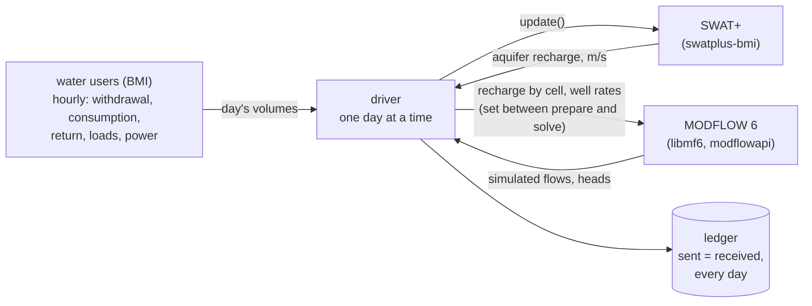
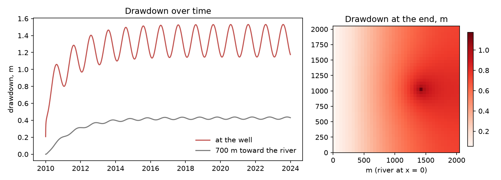

# Basin Ledger

A basin's water, quantity and quality, balanced day by day across coupled models.

Basin Ledger couples a watershed model, a groundwater model and the models of large water users through BMI, and
steps them together one day at a time with one Python driver:

- **SWAT+** through [swatplus-bmi](https://github.com/northlinehydrology/swatplus-bmi)
  ([doi:10.5281/zenodo.23963201](https://doi.org/10.5281/zenodo.23963201)), which runs stock SWAT+ 62.0.1 under
  outside control;
- **MODFLOW 6** through its own BMI/XMI (`libmf6`), from Python with USGS's
  [modflowapi](https://github.com/MODFLOW-ORG/modflowapi);
- **water users** as BMI components from
  [waterledger-models](https://github.com/northlinehydrology/waterledger), starting with data center cooling
  (`CoolingWaterBmi`).

Every volume and mass that moves between models is entered in a ledger twice, as sent and as received. A day where
they differ stops the run. Basin Ledger is a sibling of [Water Ledger](https://waterledger.org). Water Ledger
estimates one campus's water from public data. Basin Ledger follows that water through a basin's streams and aquifers.

**Status: early.** Built so far:

- the water-user interface;
- SWAT+ recharge into MODFLOW 6 (one-way), with users pumping from MODFLOW 6 wells;
- the ledger;
- tests on a synthetic example.

The design for the rest is in [docs/design.md](docs/design.md):

- the utility chain;
- feedback rules (curtailment, dry mode, drawdown limits);
- two-way stream-aquifer exchange;
- NextGen geography throughout: SWAT+ built on the hydrofabric, results keyed to its ids;
- AORC forcing;
- calibration as part of every example, jointly with PEST++ IES where there's feedback. An example without
  calibrated models is a screening run, never a study result;
- scenarios from a shared warm-up.

## How it works



Places are examples, not code. Each example (`examples/<place>/`) is one config file that wires real models for one
basin and its users, plus a script that fetches its public data and a short write-up. The engine knows nothing about
any place or any kind of water user.

## Install

Needs Python 3.11 or later, [uv](https://docs.astral.sh/uv/), and gfortran for SWAT+ (on macOS, Homebrew's `gcc`).

```bash
git clone https://github.com/northlinehydrology/basin-ledger && cd basin-ledger
uv sync
uv run python examples/synthetic/fetch.py --get     # builds SWAT+ (swatplus-bmi build) and fetches libmf6 (get-modflow)
uv run pytest                                       # about 15 seconds
uv run --group examples marimo edit examples/synthetic/notebook.py
```

## Use

```python
from basinledger.driver import Basin

b = Basin.from_config("examples/synthetic/basin.toml", run="pumping")
b.run()                       # every day of the SWAT+ project; the ledger checks each day
print(b.ledger.totals())      # m3 (and kg, MWh) per account for the whole run
b.finalize()
```

An example's config (abridged; the full schema is in `src/basinledger/config.py`):

```toml
[swatplus]
project = "{swatplus_refdata}/Osu_1hru"

[modflow6]
builder = "model:build"        # model.py writes the MODFLOW 6 simulation for the run's days

[recharge]
map = "all:aqu001"             # SWAT+ aquifers to MODFLOW 6 cells by area, or a CSV map

[[wells]]
name = "pw1"
cell = [0, 20, 28]

[[users]]
name = "plant"
component = "basinledger.testing:SyntheticUser"   # or waterledger_models.datacenter.bmi:CoolingWaterBmi
withdrawal = "well:pw1"
return = "outfall:creek"
```



*The synthetic example: SWAT+'s Osu_1hru recharge drives a small MODFLOW 6 aquifer, and a synthetic user pumps one
well. Drawdown is the difference from the same run without the user.*

## Water users

Any BMI component that reports its withdrawal, consumption and return can be a water user. Its gain, storage,
constituent loads, return temperature and electricity are optional. A component that uses its own variable names is
mapped role by role in the config. The engine checks each user's balance every step:
withdrawal + gain = consumption + return + change in storage. It then integrates the hourly rates into the daily
volumes the hydrologic models take. See [docs/design.md](docs/design.md#water-users).

## What the tests check

| What | How |
|---|---|
| Hourly to daily | daily volumes equal hourly rates integrated by hand; masses summed, temperature flow-weighted |
| A user's balance | closes every hour; a component that loses water is refused |
| Any component plugs in | a renamed component with other units, and `CoolingWaterBmi`, mapped by role |
| Area maps | volume kept exactly; over-covered cells and mismatched areas refused |
| MODFLOW 6 control | values set between prepare and solve are the ones MODFLOW 6 uses; daily steps enforced |
| Recharge | sent = received every day, against MODFLOW 6's budget file and SWAT+'s own printed recharge |
| Wells | pumped = requested = the user's withdrawal, every day |
| MODFLOW 6's budget | closes every day to 1e-7 of the gross flow, with and without pumping |
| Physics | pumping draws down most at the well, and depletes the river by less than it pumps, more over time |

## Prior work

Earlier SWAT and SWAT+ couplings with MODFLOW either compile MODFLOW-NWT into one program (SWAT-MODFLOW,
SWAT+MODFLOW) or use SWAT+'s own gwflow module. See [docs/prior-art.md](docs/prior-art.md).

## AI use

Basin Ledger was designed and directed by Andrew Sommerlot and built with an AI coding assistant (Claude, by
Anthropic), which wrote most of the code, tests and documentation under his direction and review. Whether it is right
rests on the tests: each model's own budget closes, and every transfer is checked against what the other model
received.

## License

BSD 3-Clause ([LICENSE](LICENSE)). SWAT+ is under the GNU LGPL 2.1 and runs as its own process through swatplus-bmi.
MODFLOW 6 is public domain (USGS).
