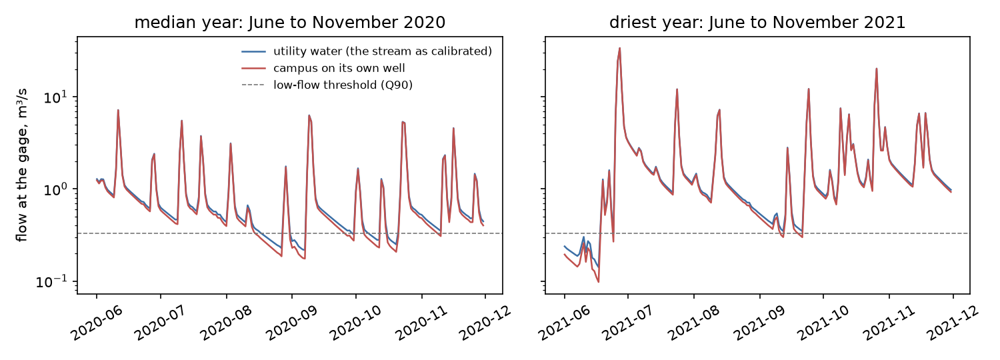
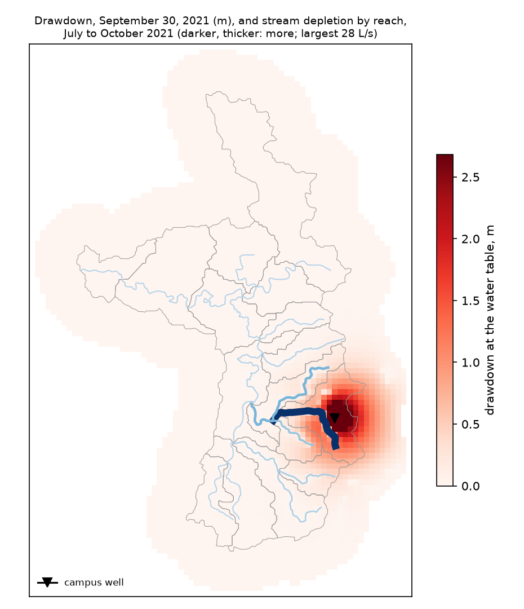
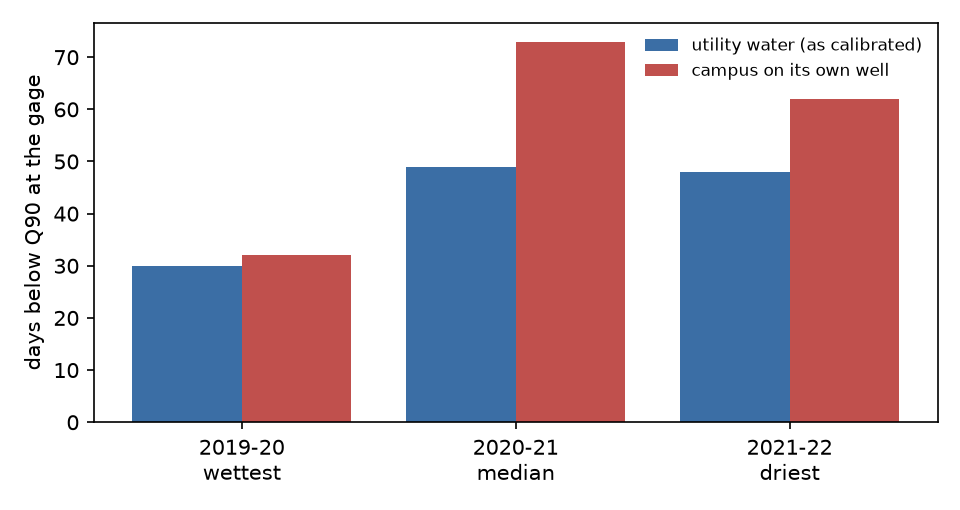
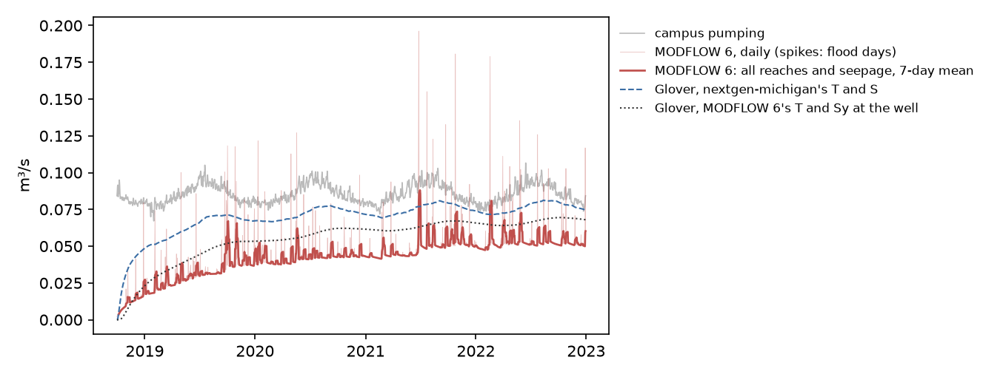

# Plaster Creek: a campus on its own wells or on utility water

**The question.** If a 300 MW data center campus in Gaines Township ran on its own wells instead of utility water,
what would Plaster Creek see in a normal year and in a dry year, and how much would that change the answer a simple
method gives?

**Short answer.** On utility water, the creek sees nothing. The water comes from Lake Michigan through Wyoming's plant
and returns to the Grand River through Wyoming's Clean Water Plant, so the binding question is the utility's capacity
(below). On its own well, the campus would lower the creek's 7-day low flow at the gage by
43 L/s (27%) in the driest year of the run
(2021-22) and by 42 L/s (20%)
in the median year (2020-21). Days below the gage's low-flow threshold (Q90) would go from
48 to 62 in the driest year. In the last year, the coupled model
takes 63% of the pumping from the streams, against 89% by
Glover's method with nextgen-michigan's settings.

**What's calibrated.** Streamflow at USGS 04119055 is calibrated (NextGen, KGE 0.87 in calibration and 0.81 in
validation). The groundwater model is screening: it is built from public data and not yet fitted to heads or base
flow.
- **Heads:** its steady heads match 55 Wellogic drift wells completed since 2000 with a mean error of
  +1.9 m and an RMSE of 7.9 m (a 66 m range).
- **Base flow:** its mean is within 4% of the
  base flow separated from the gage record. It is too steady, though: on days of below-median flow it is
  76-93% too high, and its daily NSE is near zero
  (groundwater/README.md).
- **Low flow:** the calibrated streamflow's own 7-day low flows are below the gage's. Depletion is taken off those flows,
  so the percentages below are shares of the model's low flow.
- **The campus:** an assumption [A]. Its size, cooling design and well site are not a proposal's.

## 1. The creek, with and without the well



*Flow at the gage, June to November, in the median and the driest year of the run: as calibrated (utility water) and
with the well's depletion taken off.*

| Year (April-March) | 7-day low flow, utility water (m³/s) | with the well | change | days below Q90, utility | with the well |
|---|---|---|---|---|---|
| 2019-20 (wettest) | 0.169 | 0.138 | -19% | 30 | 32 |
| 2020-21 (median) | 0.213 | 0.172 | -20% | 49 | 73 |
| 2021-22 (driest) | 0.161 | 0.118 | -27% | 48 | 62 |

Q90 is the flow the calibrated run exceeds 90% of the time from October 2019 on: 0.328 m³/s.
The gage's observed 7-day low flows in the same years were 0.322, 0.231, 0.196 m³/s.
The years are those in the calibrated run (October 2018 to December 2022). It doesn't include a drought of record such
as 2012. Its driest year, by the gage's observed 7-day low flow, is 2021-22.

## 2. Where the drawdown and the depletion are



*Drawdown at the water table on September 30 of the driest year, and the depletion of each reach from July to October.
The well is 500 m from the nearest stream cell [A].*

## 3. Days below the low-flow threshold



*Days below Q90 at the gage in each year. Utility water leaves the creek as calibrated.*

## 4. Glover's method against the coupled model



*The same pumping series through MODFLOW 6 and through Glover and Balmer's solution, with nextgen-michigan's settings
and with MODFLOW 6's transmissivity and specific yield at the well.*

Glover's method assumes one straight stream that fully penetrates a uniform, infinite aquifer, with no streambed
resistance. MODFLOW 6's daily depletion spikes on flood days. On those days the river stands above the water table, and
the drawn-down aquifer takes more water from it than it would without the well. The solid line is a 7-day mean.

MODFLOW 6 has every reach, seepage to wetlands and small streams, streambed resistance, layered glacial deposits and
the basin's edges. With the same pumping, the share taken from the streams and seepage in the last year is:
- MODFLOW 6: 63%;
- Glover with nextgen-michigan's settings (T 500 m²/d, S 0.1, 500 m): 89%;
- Glover with MODFLOW 6's settings at the well (T 175 m²/d,
  Sy 0.15, 500 m): 78%.

Most of the gap between the two Glover lines is the aquifer: MODFLOW 6's drift near the well is less transmissive than
nextgen-michigan assumed. The rest of the gap to MODFLOW 6 is the structure Glover leaves out. Streambed resistance
slows the stream's share. The rest of the pumping still comes from aquifer storage, and from flow across the basin's
edges that would otherwise have reached the creek. nextgen-michigan's own Glover result for this case, a change of −0.026 m³/s in the mean 7-day low flow,
used hourly pumping and its own years. It is the right order but isn't the same measure as the table above.

## 5. The one or two assumptions that move the answer

| Variant | change in the driest year's 7-day low flow (L/s) | depletion share, last year | days below Q90, driest year |
|---|---|---|---|
| K x0.5 | -38 | 61% | 61 |
| K x2 | -41 | 58% | 61 |
| streambed x0.1 | -24 | 51% | 57 |
| streambed x10 | -52 | 70% | 65 |
| as built | -43 | 63% | 62 |

The streambed's conductance moves the answer most. A tighter streambed delays the stream's share, and more of the
pumping comes from storage and across the edges. Halving or doubling the glacial deposits' conductivity changes the
share by a few points either way, because the well is close to the creek in both cases. These are the parameters to fit first, against base flow at the gage.

## 6. The utility case: capacity, not the creek

On utility water, the campus's water is Lake Michigan water through Wyoming's plant and BGUA's single connection.
- **The campus's withdrawal:** 1.95 MGD on average, 2.43
  MGD on its peak day.
- **BGUA's demand:** an estimated 3.7 MGD on average and 7.5 MGD on a maximum
  day [A]. With the campus's peak day added, that is 9.9 MGD, against an assumed
  contract maximum of 10 MGD [A].
- **Wyoming's plant:** the campus's peak day is 3-5%
  of the plant's headroom over average use (90-120 MGD capacity, 40 MGD average). Wyoming's 2023 reliability study, as
  Georgetown Township summarized it, already projects expansion by 2034.
- **The return:** the campus returns 0.41 MGD to the sewer on average. It goes to
  the Clean Water Plant (24 MGD, current flow assumed 12-18 MGD) and on to the Grand River, outside Plaster Creek.
- **Great Lakes accounting:** the campus consumes 1.54 MGD on average, which is
  Great Lakes consumptive use. The lake itself isn't modeled.

## Reproduce it

```bash
pip install "basinledger[users,nextgen]"
```

Then, from a checkout of github.com/northlinehydrology/basinledger:
1. Build NextGen's run with nextgen-michigan (Docker).
2. Run `examples/plaster-creek/groundwater/rerun_nextgen.py`, `fetch.py` and `prepare.py`.
3. Run `examples/plaster-creek/demo.py`.

The numbers on this page are in `examples/plaster-creek/demo-results.json`.
