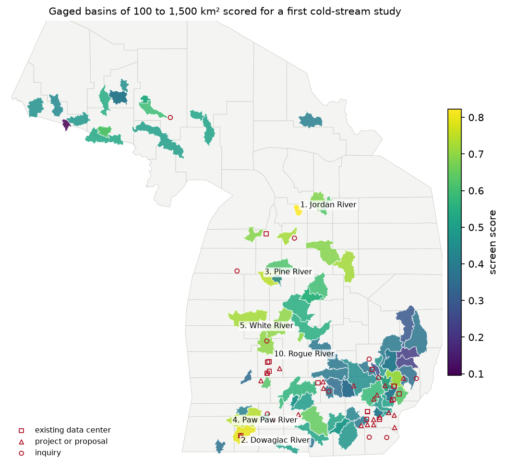

# Michigan cold-stream screen

## Summary

A screen of public data that scores Michigan's gaged basins as places to study a groundwater-sourced campus next to a
cold, groundwater-fed stream. Each unit is a USGS streamgage with at least 20 years of daily flow, still reporting in
2024 or later, with a drainage area of 100 to 1,500 km², and its NLDI basin. 78 basins are scored. Nothing here is
calibrated or modeled.

## What it shows



| | Basin (USGS gage) | km² | Score |
|---|---|---|---|
| 1 | Jordan River near East Jordan (04127800) | 175 | 0.82 |
| 2 | Dowagiac River at Sumnerville (04101800) | 659 | 0.79 |
| 3 | Pine River near Hoxeyville (04125460) | 652 | 0.75 |
| 4 | Paw Paw River at Riverside (04102500) | 1,016 | 0.74 |
| 5 | Rifle River near Sterling (04142000) | 854 | 0.73 |
| 6 | White River near Whitehall (04122200) | 1,051 | 0.73 |
| 7 | Boardman River above Brown Bridge Road (04126970) | 323 | 0.73 |
| 8 | Clinton River at Sterling Heights (04161820) | 811 | 0.72 |
| 9 | Rogue River near Rockford (04118500) | 675 | 0.70 |
| 10 | Little Muskegon River near Oak Grove (04121944) | 965 | 0.70 |

Every measure for every basin is in `screen.csv`. `screen.json` adds statewide stream length by thermal class and
ecoregion, and the basins left out.

Of the 70,400 km of reaches in Michigan's valley segment classification, 21,400 km are cold or cold-transitional.
About 40% of that length is in the northern Lower Peninsula, 48% in the Upper Peninsula and 12% in the southern Lower
Peninsula. Southeast Michigan has no cold reaches and 43 km of cold-transitional ones.

## What it measures

| Part | Weight | Measures |
|---|---|---|
| Cold water | 2 | cold and cold-transitional share of the valley segment network; designated trout stream length per km² |
| Groundwater | 1 | base flow index (Eckhardt filter, BFImax 0.8 [A]); Q90/Q50, water years 1997–2025 |
| Temperature data | 1 | years of daily water temperature at the gage; Water Quality Portal stream temperature results since 2010 |
| Aquifer | 1 | outwash share and coarse-unit share of the surficial geology |
| Siting | 1 | OSM transmission lines (138 kV and up) and substations in the basin |
| Irrigation | 0.5 | groundwater irrigation per km², USGS 2015 county totals spread by area [A] |
| Data centers | 0.5 | Water Ledger's public tracker: existing data centers, projects, inquiries and moratoria in or within 15 km of the basin |

Each part is a percentile rank or a simple step in [0, 1]. The score is their weighted mean. The weights are judgment
[A]. `screen.py` has the exact rules, and `fetch.py` lists every source.

## Limitations

- **The weights are judgment.** A different weighting reorders the list.
- **Thermal class and trout designation don't always agree.** Augusta Creek is a designated trout stream along its
  whole length but is classed warm-transitional. Segments that touch a basin count in full.
- **Irrigation is county-level.** Summer rates are several times the annual average used here.
- **Tracker records sit at their place's centroid.** A campus's actual site can be a few kilometres away. Water
  sources aren't checked.
- **OSM transmission coverage is good but not complete.**
- **The 1981 aquifer map isn't used.** Its server's certificate chain doesn't verify from Python.
- **Some basins are left out.** NLDI has no basin for 04057814. Pigeon River (04128990) and Farmers Creek (04146000)
  are left out because their NLDI areas differ from USGS's by more than 25%.
- **Gages only.** Streams without a qualifying gage, such as Paint Creek in Oakland County, are only seen inside a
  larger basin.
- **Not checked:** lakes and impoundments, existing high-capacity wells, and temperature loggers held outside the
  Water Quality Portal.

## Run

```bash
uv sync --group gis --group examples
uv run --group gis python examples/michigan-cold-streams/fetch.py      # public data to the cache (~45 MB)
uv run --group gis python examples/michigan-cold-streams/screen.py     # screen.csv, screen.json
uv run --group gis --group examples python examples/michigan-cold-streams/figure.py   # screen-map.png
```
