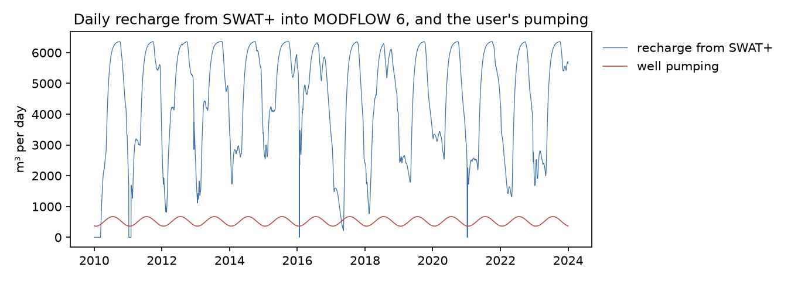
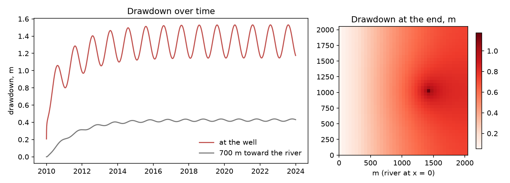
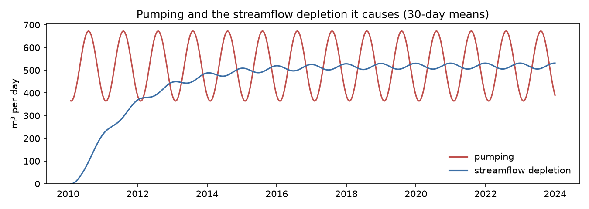

# Synthetic example

The engine's test case. It wires real models, but the place and the numbers mean nothing.

- **SWAT+:** the Osu_1hru project that ships with SWAT+ (one 10 ha HRU, one aquifer, 2010–2023), run one day at a time
  through swatplus-bmi. Its aquifer's daily recharge rate is the only thing passed on.
- **MODFLOW 6** (`model.py`, built with flopy): one layer, 41 × 41 cells of 50 m, 100 m thick, K = 5 m/d, specific
  yield 0.15, transmissivity held constant. A river runs along the west edge (stage 88 m); the other edges are
  no-flow. The recharge rate from SWAT+ is applied to every cell (the map `all:aqu001`), so the grid receives about
  4.2 km² × Osu's recharge. A real example maps matching areas from the same geography.
- **Water user:** the synthetic user (`basinledger.testing.SyntheticUser`, `user.toml`), hourly. It withdraws about
  520 m³ a day from well `pw1`, with daily and seasonal cycles. 70% is consumed, and the rest plus a 1% gain goes to
  an outfall account. It also reports a dissolved solids load and electricity.
- **Calibration:** none, and no record, so the engine labels it a screening run. Its objects keep their SWAT+
  names; it has no hydrofabric.

Run it:

```bash
uv run python examples/synthetic/fetch.py --get                     # SWAT+ (2 compile jobs) and libmf6, if missing
uv run pytest                                                       # the tests use this example (3 years)
uv run --group examples marimo edit examples/synthetic/notebook.py  # the whole period, with and without the user
```

What the notebook shows: drawdown at the well settles at about 1.1–1.5 m with a seasonal swing. Streamflow depletion
reaches the mean pumping rate after about five years, because every cubic meter pumped eventually comes from the
river in this model.




